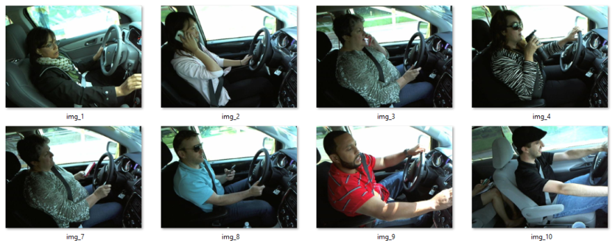
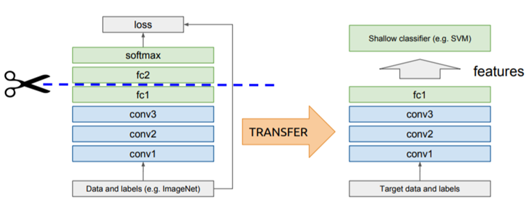
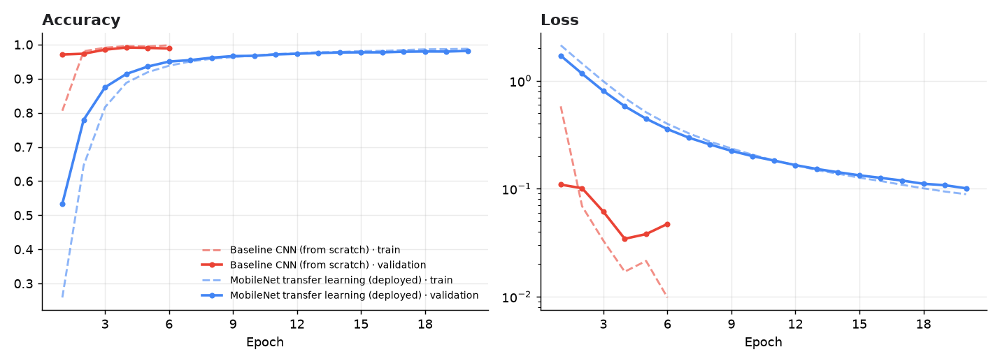
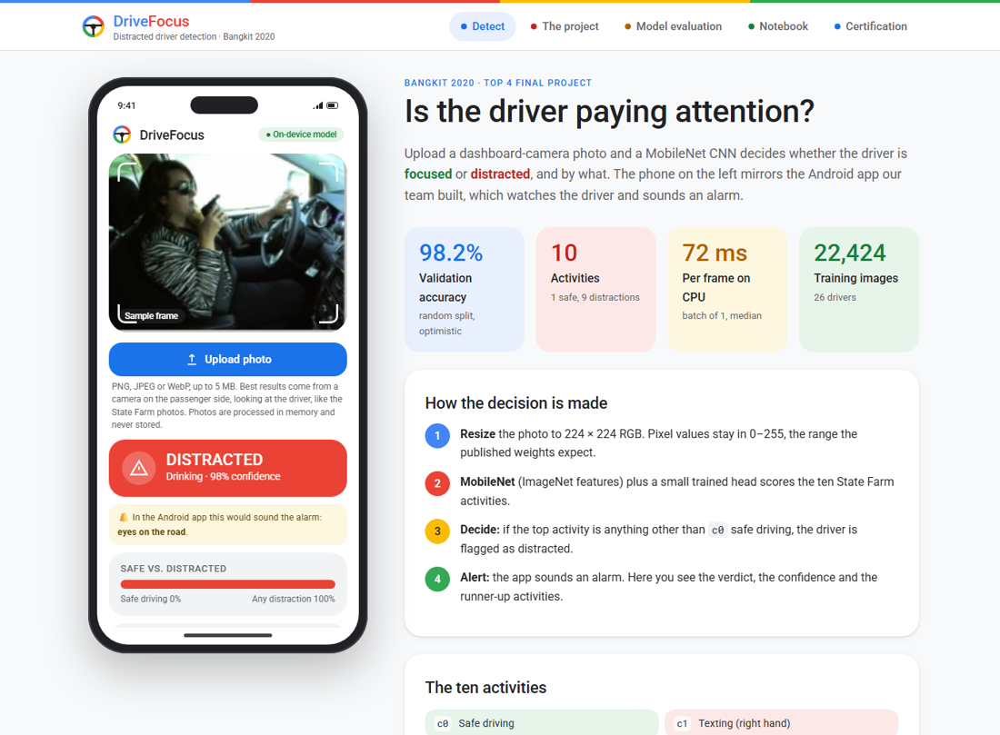
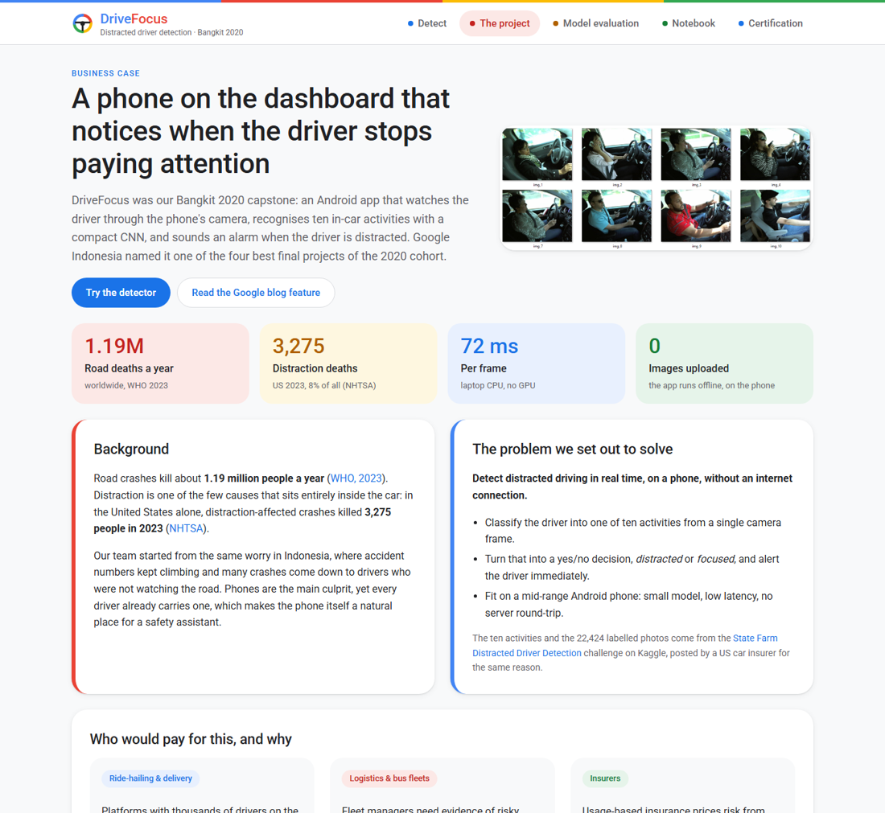
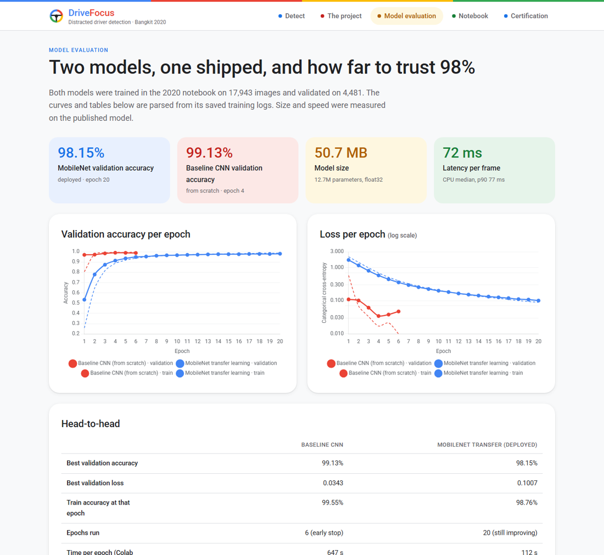
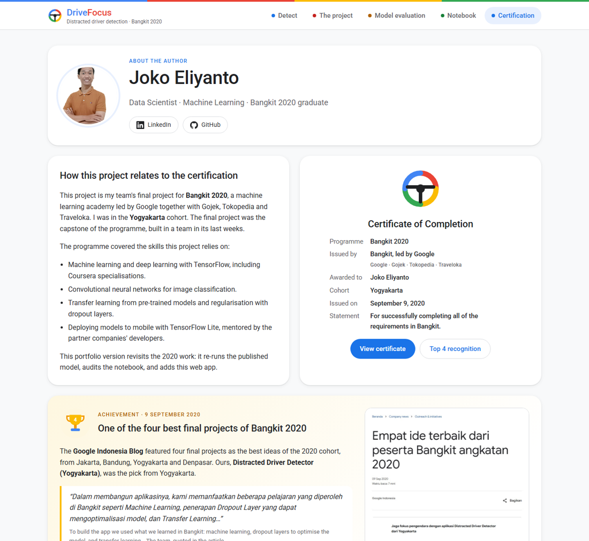
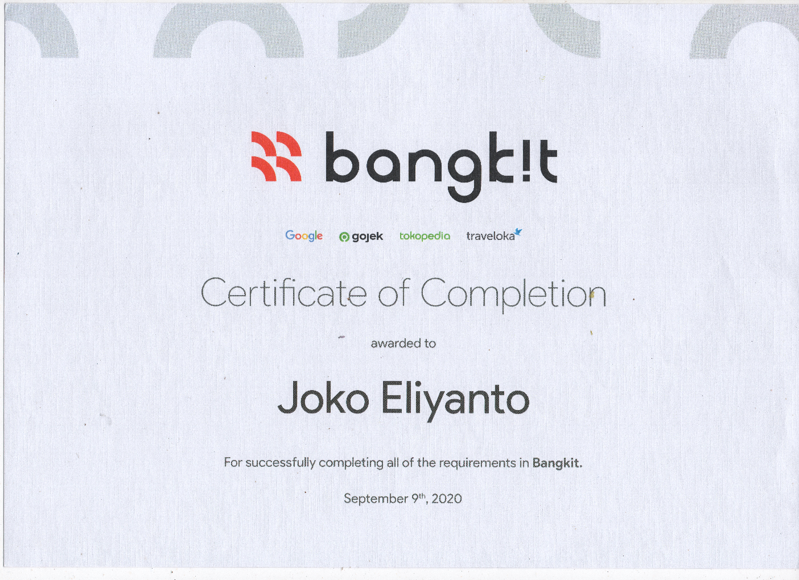
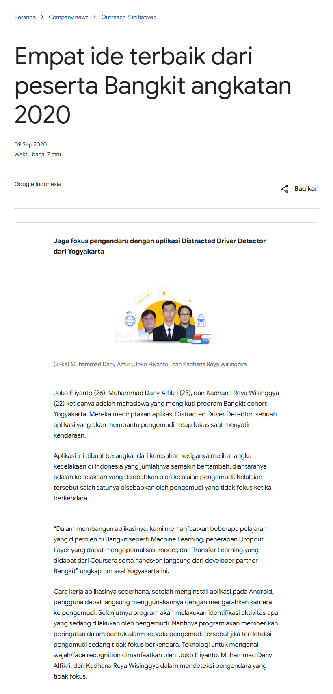

# Distracted Driver Detection with MobileNet

**A phone-friendly CNN that flags distracted driving from a dashboard-camera photo. My team's Bangkit 2020 final project,
featured by Google Indonesia as one of the four best projects of the cohort.**


> 🏆 **Bangkit 2020 · Top 4 final project.** Built by **Joko Eliyanto, Muhammad Dany Alfikri and Kadhana Reya
> Wisinggya** (Yogyakarta cohort) for **Bangkit**, the machine learning academy
> led by Google with Gojek, Tokopedia and Traveloka. Featured in
> [*"Empat ide terbaik dari peserta Bangkit angkatan 2020"*](https://blog.google/intl/id-id/company-news/outreach-initiatives/2020_09_empat-ide-terbaik-dari-peserta-bangki/)
> on the Google Indonesia Blog, 9 September 2020 ([screenshot](certificate/bangkit-top4-blog.png)). The original
> notebook is kept in [notebooks/original_bangkit_capstone.ipynb](notebooks/original_bangkit_capstone.ipynb). This
> repository revisits that work with an audit of the notebook, measured model metrics and a Django web app.

---

## Table of Contents

- [Business Problem](#business-problem)
- [Key Results](#key-results)
- [Dataset](#dataset)
- [Approach](#approach)
- [Evaluation](#evaluation)
- [Audit of the 2020 Notebook](#audit-of-the-2020-notebook)
- [Web App](#web-app)
- [Repository Structure](#repository-structure)
- [How to Run](#how-to-run)
- [Limitations and Next Steps](#limitations-and-next-steps)
- [Certification](#certification)

---

## Business Problem

Road crashes kill about **1.19 million people a year** ([WHO, 2023](https://www.who.int/publications/i/item/9789240086517)).
Distraction is one of the few causes that sits entirely inside the car: in the US alone, distraction-affected crashes
killed **3,275 people in 2023**, 8% of all road deaths ([NHTSA](https://crashstats.nhtsa.dot.gov/Api/Public/Publication/813703)).

The goal was an **Android app** that watches the driver through the phone's camera, recognises what they are doing and
**sounds an alarm when they are distracted**. It has to run in real time, offline and on a mid-range phone.

| Stakeholder | Value |
|---|---|
| Ride-hailing and delivery platforms | Fewer crashes and claims across large driver fleets, at almost no cost per driver |
| Logistics and bus fleets | A leading indicator of risky behaviour for coaching, not just crash reports |
| Insurers (usage-based insurance) | Distraction events per km as a behaviour-based risk signal |

**Success metrics:** distraction recall (a missed distraction is the costly error), false alarms per hour (too many and
drivers mute the app), latency per frame, and, above all, accuracy on drivers the model has never seen.

## Key Results

| | Baseline CNN (from scratch) | **MobileNet transfer learning (deployed)** |
|---|---|---|
| Best validation accuracy | 99.13% (epoch 4) | **98.15%** (epoch 20) |
| Best validation loss | 0.034 | 0.101 |
| Training time per epoch (Colab GPU) | 647 s | **112 s** |
| Parameters (trainable) | 6.29M (6.29M) | 12.68M (9.45M) |
| Model size / CPU latency | – | 50.7 MB / **~72 ms per frame** |

- ✅ The deployed model reaches **98.2% validation accuracy** on 10 activities.
- ⚖️ **The baseline scores one point higher, but MobileNet was shipped:** its frozen ImageNet features cannot memorise
  the 26 drivers in the data, it was still improving at the last epoch, and it trains ~6× faster per epoch.
- ⚠️ **98% is an upper bound.** The validation split is random, so the same drivers appear in training and validation.
  The honest test for this product is a split by driver (see [Evaluation](#evaluation)).
- 🔍 **The audit found four issues** in the 2020 notebook, including a preprocessing mismatch: the published weights
  expect raw 0–255 pixels, not the notebook's `rescale=1/255`. The web app uses the input the weights actually expect.

## Dataset

[State Farm Distracted Driver Detection](https://www.kaggle.com/c/state-farm-distracted-driver-detection/data) (Kaggle):
**22,424 labelled photos** of **26 drivers**, taken by a camera on the passenger side, in 10 classes.



| Code | Activity | | Code | Activity |
|---|---|---|---|---|
| c0 | **Safe driving** | | c5 | Operating the radio |
| c1 | Texting (right hand) | | c6 | Drinking |
| c2 | Talking on the phone (right) | | c7 | Reaching behind |
| c3 | Texting (left hand) | | c8 | Hair and makeup |
| c4 | Talking on the phone (left) | | c9 | Talking to passenger |

For the alert, **c0 is "focused" and c1–c9 are "distracted"**. The dataset needs a Kaggle account and accepting the
competition rules, so the images are not in this repository.

## Approach

```
Kaggle images → 224×224 generators, random 80/20 split (17,943 / 4,481)
→ Baseline CNN from scratch  ─┐
→ MobileNet transfer learning ─┴→ compare → export (TensorFlow Lite for Android, TensorFlow.js for the web)
```

- **Baseline:** 4 Conv2D + MaxPooling blocks (512-256-128-64 filters), Dense 512, softmax 10, Adam 1e-4, early
  stopping.
- **Transfer learning:** ImageNet [MobileNet v1](images/mobnet.PNG) with frozen weights + Conv2D 1024 + **Dropout 0.2**
  + global average pooling + softmax 10. MobileNet's depthwise-separable convolutions were designed for phones.



## Evaluation



*Curves re-drawn from the Keras logs saved in the notebook (dashed: training, solid: validation).*

**How far to trust 98%.** Keras' `validation_split` takes 20% of each class folder at random, and State Farm photos are
consecutive frames of 26 drivers. The same person, car and clothes appear on both sides of the split, so validation is
much easier than meeting a new driver. A driver-level split (GroupKFold on `subject` in `driver_imgs_list.csv`) is the
right test before deployment.

**Full evaluation.** The 2020 notebook saved training logs only. [scripts/evaluate.py](scripts/evaluate.py) rebuilds
the notebook's exact validation subset from the Kaggle files and writes the confusion matrix, per-class
precision and recall, distraction recall, false-alarm rate and accuracy per driver to `models/evaluation.json`. The web
app shows them once that file exists.

## Audit of the 2020 Notebook

| # | Finding | Evidence | Handling |
|---|---|---|---|
| 1 | Published weights expect **raw 0–255 pixels**, not `rescale=1/255` | On the 8 example frames, raw input gives 4 different activities; rescaled input gives the same class for all 8 (probability spread 0.0001) | The app feeds raw pixels |
| 2 | **Class order** is Kaggle `c0`–`c9`, not the notebook's renamed, alphabetically sorted folders | Only the c0–c9 order gives sensible predictions (e.g. the drinking frame → c6) | `models/labels.txt` and the app use c0–c9 |
| 3 | The "improvement model" plot repeats the **baseline curves** | It calls `plot_train_history(history)` instead of `history1` | Curves re-drawn from the logs |
| 4 | Saved outputs come from **more than one session** | 18 steps/epoch implies ~1,000-image batches vs `BATCH_SIZE = 16`; `model.json` stores lr 0.001 vs 1e-5 in code | Results reported from the logs as saved |

The architecture and parameter count of the published model (12,677,322) match the notebook exactly.
[scripts/build_metrics.py](scripts/build_metrics.py) reproduces every number above.

## Web App

A Django app with a Google-colour, Material-style design. The detector page looks like the phone app.

| Page | What it shows |
|---|---|
| **Detect** | A phone mock-up: upload a dashboard photo (or tap a sample) → **DISTRACTED / FOCUSED** verdict, activity, confidence, safe-vs-distracted meter and top-3 activities |
| **The project** | Background, business case, stakeholders, solution flow, success metrics, risks, privacy and team |
| **Model evaluation** | Interactive training curves, head-to-head comparison, the trust caveat, confusion matrix (when available) and the notebook audit |
| **Notebook** | The original Colab notebook rendered with section headings, download and GitHub links |
| **Certification** | Author profile, Bangkit certificate, and the Top 4 recognition with a link to and screenshot of the Google blog article |

| | |
|---|---|
|  |  |
|  |  |

It also has a JSON API:

```bash
curl -F image=@driver.jpg http://127.0.0.1:8000/api/predict/
# {"code": "c6", "label": "Drinking", "distracted": true, "confidence": 0.98, "p_safe": 0.0, ...}
```

## Repository Structure

```
├── certificate/            Bangkit certificate, Google blog screenshot and link
├── images/                 Figures (dataset examples, MobileNet, training curves)
├── legacy/tfjs_demo.html   The 2020 TensorFlow.js demo page
├── models/
│   ├── tfjs/               Published model: model.json + 13 weight shards (50.7 MB)
│   ├── labels.txt          Class names in model output order (c0–c9)
│   └── metrics.json        Training history, size, latency, preprocessing check
├── notebooks/original_bangkit_capstone.ipynb   The 2020 Colab notebook (unchanged)
├── scripts/
│   ├── build_metrics.py    Parses the notebook logs, measures the model, writes metrics + figures
│   └── evaluate.py         Full evaluation on the Kaggle images (confusion matrix, per driver)
└── webapp/                 Django app (detector/ app, driver_site/ project, tests)
```

## How to Run

```bash
python -m venv .venv && source .venv/bin/activate      # Windows: .venv\Scripts\activate
pip install -r requirements.txt

python scripts/build_metrics.py                        # optional: rebuild models/metrics.json and figures

cd webapp
python manage.py test detector                         # 15 tests
python manage.py runserver                             # http://127.0.0.1:8000
```

The model is rebuilt in Keras from the TensorFlow.js shards at the first prediction
([webapp/detector/tfjs_loader.py](webapp/detector/tfjs_loader.py)), so there is no second copy of the weights.

## Limitations and Next Steps

- **New drivers:** retrain and evaluate with a driver-level split; report distraction recall and false alarms per hour.
- **Right-hand-drive cars:** State Farm cars are left-hand drive; Indonesian cars are right-hand drive. Mirror the images
  (swapping left/right labels) or collect local data.
- **Conditions:** add night/infrared frames, other car interiors and camera positions.
- **Fewer false alarms:** alert only when a distraction lasts several frames.
- **Smaller model:** fine-tune and quantise MobileNet (int8 TensorFlow Lite) for older phones.

## Certification

**Bangkit 2020, Certificate of Completion**, awarded to Joko Eliyanto on 9 September 2020 "for successfully completing
all of the requirements in Bangkit". This project was the final project, and the Google Indonesia Blog featured it among
the four best ideas of the cohort.

| Certificate | Recognition |
|---|---|
|  | [](https://blog.google/intl/id-id/company-news/outreach-initiatives/2020_09_empat-ide-terbaik-dari-peserta-bangki/) |

---

**Author:** Joko Eliyanto · [LinkedIn](https://www.linkedin.com/in/joko-eliyanto-23a1b6143/) · [GitHub](https://github.com/jokoeliyanto)
· Team: Muhammad Dany Alfikri, [Kadhana Reya Wisinggya](https://github.com/KadhReyA/state-distracted-cnn)
